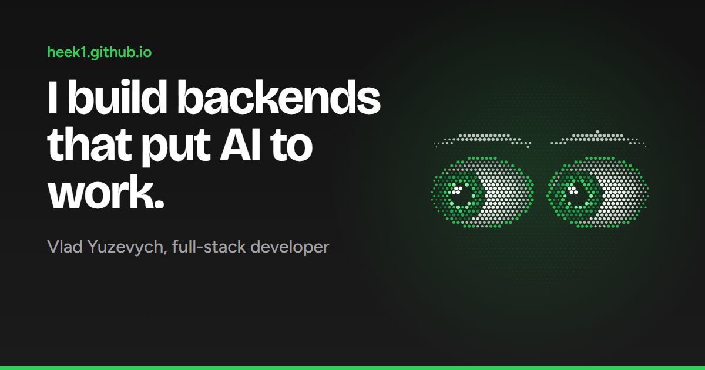

# heek1.github.io

My portfolio site: **[heek1.github.io](https://heek1.github.io/)**



## What's on it

- **Live stack map** in the hero: my stack drawn as a running system. Requests travel along dotted wires from the interface to services, AI and data; clicking a technology highlights the projects that use it.
- **Dot-matrix eyes** in About: a few thousand dots on springs that follow the cursor, blink, raise their brows at links and ripple when clicked. A small pair keeps watching from the header, another one watches the "Copy email" button, and a lost one lives on the 404 page.
- **Selected projects** with tilting screenshots that flip over to show how each project works.
- **Journey**: a timeline that fills as you scroll.
- **Try my API**: a console where I answer like a backend would, including `GET /vlad/coffee`.

All animation pauses off-screen and respects the reduced motion setting.

## Stack

Next.js (static export), React, TypeScript, CSS Modules and the Canvas 2D API, deployed to GitHub Pages with GitHub Actions.

## Run it

```bash
npm install
npm run dev
```

`npm run build` produces the static site in `out/`. Every push to `main` builds and deploys it ([deploy.yml](.github/workflows/deploy.yml)).

## Structure

| Path | What |
|---|---|
| `src/app` | Page, layout, 404 and social preview image |
| `src/module/Home/Hero` | Stack map |
| `src/module/Home/About` | About text and the eyes (`Watcher.tsx`) |
| `src/module/Home/Projects` | Project showcase, data and "How it works" pipelines |
| `src/module/Home/Journey` | Timeline |
| `src/module/Home/Api` | API console and its responses |
| `src/module/Home/Contact` | Contact section and footer |
| `src/components` | Header, mini eyes, contact menu, text links |
| `public` | Project screenshots and redirects for old project pages |
